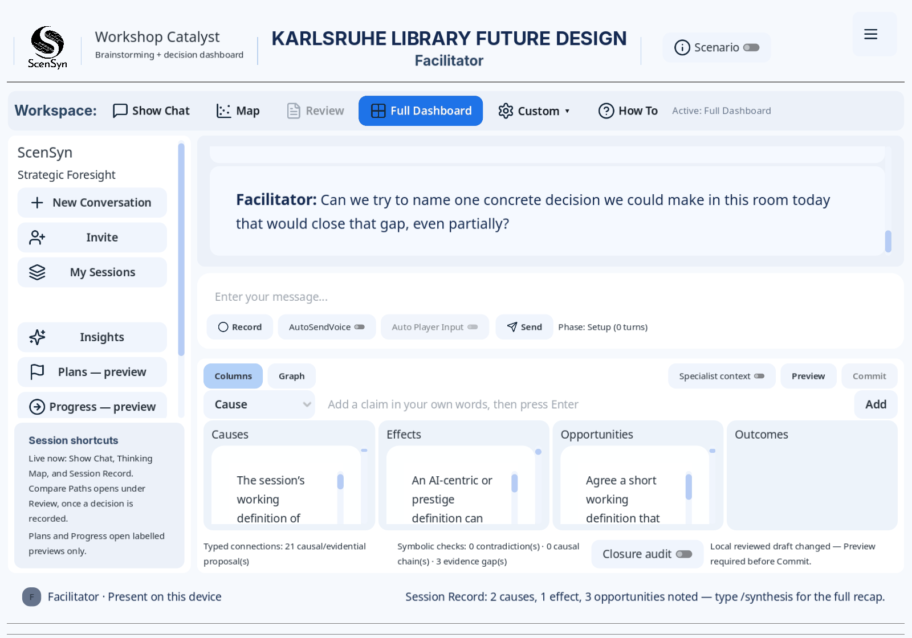
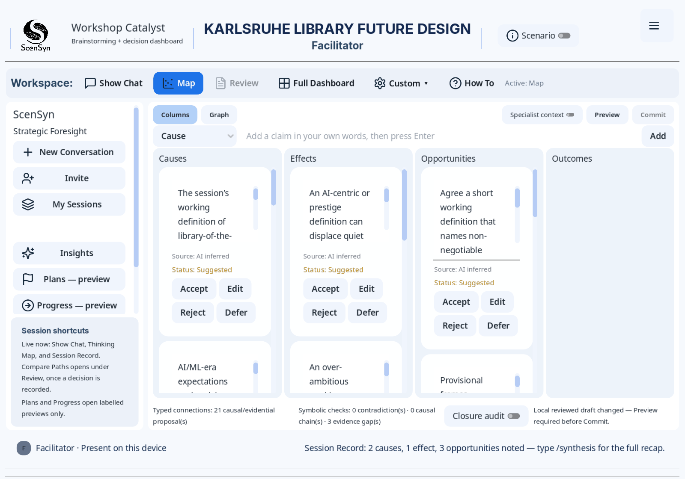
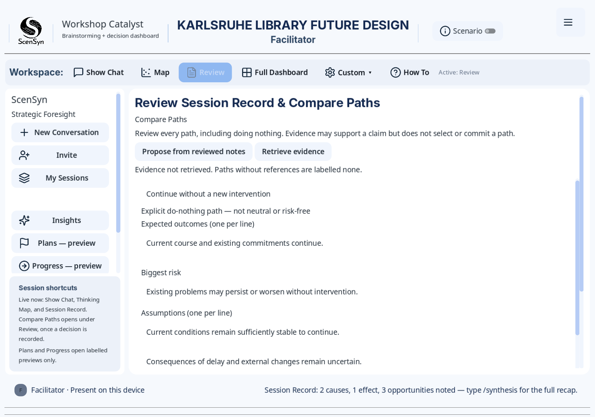
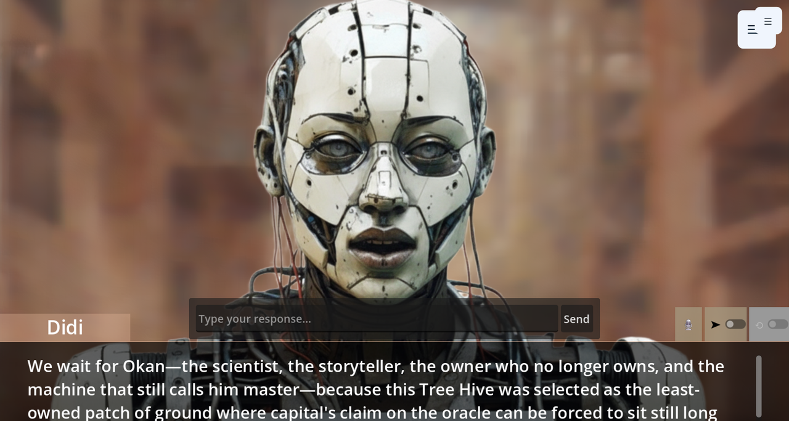
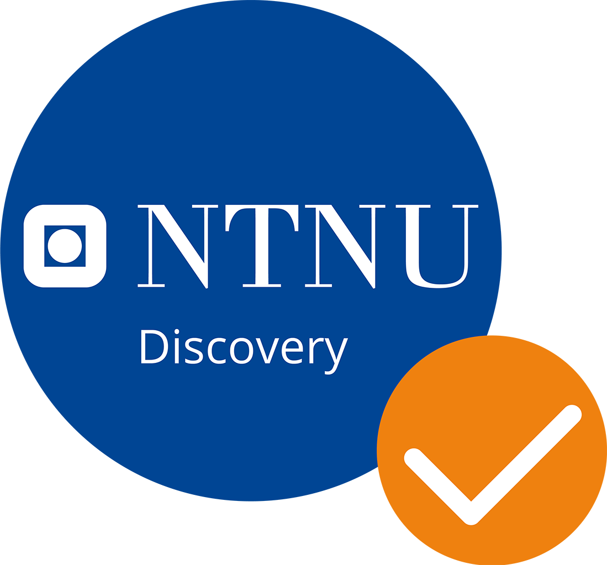

# Synesyn

Synesyn is a local-first, 'artifact-centric' platform that enables the creation of applications built for reasoning with AI over shared material, while building up a traceable record that each session can build on. Combining artistic praxis, speculative design and AI-assisted sense-making, it
implements the **Metapunkt method** for 'forward remembrance': synergistically reading backward to patterns held in data and remembering forward into speculative futures, to support well grounded decision making.

With Synesyn, everything produced — prompts, images, scenarios, projections, closures — is stored as a **versioned artifact with provenance**, so the output of one workshop can be the input to the next, and any result can be traced back to the inputs, models and human decisions that produced it.

Synesyn is research software, currently being developed through a pilot phase towards public use. Expect rough edges, and read [`docs/`](docs/README.md) if uncertain.

## What it looks like



**Workshop Catalyst**, screenshot from a session on the future of a city library.
The facilitator's question is at the top; underneath, the material the session has
produced so far.

| | |
| --- | --- |
|  |  |
| **The Thinking Map** — the system proposes; a person accepts, edits, rejects or defers | **Review** — possible paths compared, including the option of doing nothing |



**Story Stage**, the same session machinery seen from a different mode — Story Catalyst's (dialogic narrative based system) visual view, where characters appear on a staged backdrop with their lines spoken via text-to-speech alongside the chat transcript.
The character art that drives the avatar display in Story Stage is packaged as an [optional download](docs/user-guide/story-stage-sprites.md);
without which the stage falls back to a basic visualiser. A saved session can be played back later like a recording, by clicking **Play a Story Log** in the settings.

## How to read this repository

Synesyn is not one program. It is **platform infrastructure plus indicative applications built on it**, and this platform infrastructure is organized into three layers:

| Layer | Where | What it is |
| --- | --- | --- |
| **Hub** | [`services/synesyn_hub/`](services/synesyn_hub/) | An optional Python service: artifact storage, job orchestration, voice, realtime events |
| **Infrastructure** | [`synesyn_client/addons/`](synesyn_client/addons/) | Reusable Godot addons that shape the platform. No product narrative of their own |
| **Applications** | `synesyn_client/ScenSyn/`, `synesyn_client/readymade/` | End-user applications that consume the infrastructure |

The distinction is structured such that applications depend on addons, and addons reach shared behaviour through `synesyn_core`a 'central coordinating' add-on for the system. That is what makes the infrastructure reusable, and available for developing applications that do not exist yet.

### The infrastructure layer

Reusable addons under [`synesyn_client/addons/`](synesyn_client/addons/) with their capabilities:

| Addon | Capability |
| --- | --- |
| `synesyn_core` | Shared library behind the addon boundary: config, hub client, paths. No dock, no product UI |
| `syntree` | Content source and context management; conversation and prompt-chain management |
| `synaxes` | Pattern synthesis over accumulated material; commits `ui.closure` artifacts |
| `synpunkt` | Authoring, rendering, and presentation tools that build from closures |
| `metapunkt` | AI agent orchestration for role-based ensembles |
| `syntree_voice` | Speech synthesis, transcription and lip sync utilities |
| `story_stage` | A stage for a story told line by line: sprites, backdrops, dialogue, voice. Told what to show by the application hosting it|
| `synesyn_visual_profiles` | Shared visual/theme profiles across applications |
| `limboai` | Third-party behaviour trees. **Not redistributed here** — fetched at setup |

### The application layer

Launching the client opens a small launcher with four destinations:

| Destination | What it is | State |
| --- | --- | --- |
| **ScenSyn** | Session runtime for scenario work, in two session types (see below) | Structure established; still developing |
| **ReadyMade** | Agentic content planning over a long-running workplan | Crude; substantial work needed |
| **Play a Story Log** | Replays a saved session on Story Stage, paced, optionally looped | Small applet; the first application built on `story_stage` outside ScenSyn |
| **Synesyn Tools** | A shell hosting the SynTree, SynAxes and SynPunkt docks directly | Utility surface, not a standalone application |

**ScenSyn** is the most developed application thus far built on Synesyn and the best place to understand how the Synesyn platform may be used. **ReadyMade** is still early in its development: still to be treated as a working sketch of a second application rather than a finished one.

### Build your own application

The layering exists so that ScenSyn and ReadyMade are **examples rather than prescriptive use cases for the Synesyn framework**. If you want a different application — a different kind of session, a different facilitation model, a domain-specific tool — the intended path is to add your own application directory alongside the existing ones and consume the addons, in similar fashion.

[`docs/developer-guide/building-on-synesyn.md`](docs/developer-guide/building-on-synesyn.md) covers the layer boundaries, how to register a new ScenSyn session type or scenario collection, and how to start a separate application.

Contributions back to the infrastructure are actively wanted, and are more valuable than contributions to any one application. If building something on Synesyn forces you to reach across a boundary, work around a missing extension point, or copy code out of an addon, that might hold insight about the infrastructure worth raising as an issue on — see [`CONTRIBUTING.md`](CONTRIBUTING.md).

## ScenSyn: two session types

ScenSyn is one application containing two distinct *session types**. They share the runtime — scenario loading, AI character rotation, the story log, voice — and diverge in what a session is *for*. Each session type owns one or more **collections**, which group scenarios of a similar kind.

### Workshop Catalyst — facilitated group foresight

A facilitator runs a timeboxed workshop through a staged agenda. AI specialists analyse contributions **out of sight** and surface structure rather than speaking as characters. It produces a decision record the group can process during and after each session.

Built in and working: staged agendas defined per scenario, facilitator commands for notes, decisions, risks, deferrals and votes; a **Thinking Map** of claims and relationships the facilitator accepts, edits or rejects; a **Session Record** targeting three decisions, two risks and one deferred question; **Compare Paths** for weighing options against a baseline; Markdown exports; and resuming an earlier session.

A workshop currently runs **on one device**, on which multiple sessions may be started for more participants. Remote participants, multi-client synchronisation and invitations not yet implemented.

Collection: Workshop Catalyst currently has one collection: **Decision Triage** which stages sessions that help groups weigh options, capture key risks, and reach a decision during a facilitated workshop. Workshop Catalyst enables the instant creation of custom scenarios for this purpose while more complex / bespoke implementations can also be pre-developed using the available infrastructure. 

### Story Catalyst — narrative and cultural exploration

With Story Catalyst, an ensemble of AI characters speak **in their own voices**, playing in scenarios that can also be optionally staged
visually with sprites and synthesised speech. Unlike Workshop Catalyst, the objective here is rehearsal and resonance rather than a decision record.

Story Catalyst comes pre-loaded with several scenario collections, including five near-future civic dilemmas under **Sustainability**, two dramaturgically-rich scenarios for **Cultural Narratives** (*Ireti Okan* and *Stochastic Dreams*), and an open slot for creating your own scenarios in **Open Play**. 

The character art used in these sessions features unique visual representations tailored for each character, enriching the experience with illustrated sprites. However, because the full set of artwork is quite large (about 545 MB), it is distributed as a separate, optional download rather than bundled directly with the repository. This keeps the core download manageable and lets users choose whether to add the full sprite packs ([sprite packs](docs/user-guide/story-stage-sprites.md)).

There are three collections in Story Catalyst, which differ in theme and execution:

| Collection | What it enables | Shipped |
| --- | --- | --- |
| **Sustainability** | Near-future civic dilemmas, with discussion tracked across energy, community, innovation, environment and equity | 5 scenarios |
| **Cultural Narratives** | Culturally grounded, dramaturgically scored pieces, with relational matrices and phase guidance, tending more towards the notion of 'generative theatre' | 2 scenarios, including *Ireti Okan* and *Stochastic Dreams* |
| **Open Play** | Author your own scenario in the application and save it to a personal library; no didactic overlay | No bundled scenarios — [you write them](docs/user-guide/story-catalyst-authoring.md) |

See [Story Catalyst](docs/user-guide/story-catalyst.md) for what each
collection expects, and [ScenSyn](docs/user-guide/scensyn.md) for the shared
runtime.

Bundled scenarios in both session types are plain `.txt` files with bracketed sections (`[SCENARIO]`, `[CHARACTERS]`, `[PHASE_GUIDANCE]`, `[WORKSHOP_AGENDA]`, `[VOICES]`), so writing one needs no code — see
[workshop scenario authoring](docs/developer-guide/workshop-scenario-authoring.md).
Open Play works differently: you draft a story inside the application and it is saved to your own library, which makes it a quick and fun way to try your own material
([authoring guide](docs/user-guide/story-catalyst-authoring.md)).

## Other ways to use this

The project was built for foresight work, but the infrastructure is not limited to only one type of use case. Here are use cases the current code supports. While facilitated foresight workshops and performance have been exercised in practice, treat the rest as informed suggestions rather than trodden paths:

| If you want to | Start from |
| --- | --- |
| Run a decision meeting that leaves a traceable record | Workshop Catalyst, ignoring the futures framing |
| Stage a performance or installation with speaking AI characters | Story Catalyst's Cultural Narratives, with Story Stage; **Play a Story Log** to show it again, or loop it in an exhibition |
| Teach with role-play, then analyse the transcript | Open Play, which takes minutes to author |
| Rehearse a hard conversation — negotiation, crisis, onboarding | Open Play, with a cast whose interests conflict with yours |
| Think through your own document corpus, with no session at all | The Synesyn Tools shell: SynTree, then SynAxes |
| Build a different Godot application on AI and artifact infrastructure | The addons, and [building on Synesyn](docs/developer-guide/building-on-synesyn.md) |
| Put a different front-end on a local-first artifact store | The [hub API](docs/developer-guide/hub-api.md), with no Godot client |

Three of those are worth articulating some more:

**Workshop Catalyst does not require a speculative subject.** The staged agenda, Thinking Map, Compare Paths and Session Record assume a group deciding something under time pressure, not a group discussing the future. A migration decision, a grant panel, a post-incident review or a hiring debrief all fit, and all leave the same artefact types: decisions, risks and deferred questions, attributed and exportable. The scenario file *is* the agenda, so you supply the subject.

**The tools work without the applications.** The Synesyn Tools shell opens the SynTree, SynAxes and SynPunkt docks directly, which makes the project usable as a reading-and-synthesis workbench over your own material — build a context graph, find patterns, commit closures, lay the result out on a canvas — with no session and no facilitation.

**It is usable as research apparatus.** Because every session records what was said, by whom, from which model and following which human decision, a session is also a dataset about how a group reasons with AI present. That was built for accountability, but it makes the software a plausible instrument for studying the process of deliberation itself.

## Getting started

Setup, prerequisites and the one required manual step (installing the LimboAI binaries, which are not redistributed here) are in
[`docs/developer-guide/local-dev.md`](docs/developer-guide/local-dev.md).
For orientation as a user rather than a contributor, start at
[`docs/user-guide/getting-started.md`](docs/user-guide/getting-started.md).

A running session needs a model provider configured. The hub is optional: the client runs without it with reduced features, and when present the client starts and adopts it automatically.

Two sets of files are excluded from this repository because of their size, and `.gitignore` records both. The LimboAI binaries are required before the project will open cleanly; the Story Stage character art is entirely optional and has its own [installer](docs/user-guide/story-stage-sprites.md).

## What you can run today

Two of these need nothing but the repository — no hub, no API key, no model
provider — which makes them the fastest way to confirm the project works on your
machine:

```bash
# Hub test suite (Python). Needs no running hub.
cd services/synesyn_hub && python -m pytest tests/

# A headless client test suite (Godot). Needs no hub and no model provider.
godot --headless --path synesyn_client \
  --script res://ScenSyn/tests/test_session_type_registry.gd
```

Further headless suites sit in `synesyn_client/ScenSyn/tests/`, the Workshop
Catalyst ones being the most extensive.

Whole workflows are verified by executable JSON specs rather than prose, so a reviewer can confirm claims without reading artifacts by hand. These drive a real session and so **do** need a model provider configured:

```bash
python utilities/harness/test_harness.py \
  --spec docs/technical-review/run_specs/scensyn_workshop_catalyst_smoke.json
```

Specs exist for both session types, including Story Catalyst's sustainability and cultural collections. One, `playback_smoke.json`, replays a bundled log and needs no model provider. See
[`docs/technical-review/run_specs/`](docs/technical-review/run_specs/README.md).
Policy checks, including the line-limit ratchet, live in
[`utilities/checks/`](utilities/checks/README.md).

## Documentation

[`docs/README.md`](docs/README.md) routes by user requirements: one path for running a session, one for working on the code. If you are unsure where a document belongs,
[`docs/SYSTEM_MAP.md`](docs/SYSTEM_MAP.md) records which document owns what.

Read [`docs/concepts/glossary.md`](docs/concepts/glossary.md) early. Several
terms — *closure* above all — mean something specific here.

| Where | Question it answers |
| --- | --- |
| [`docs/user-guide/`](docs/user-guide/README.md) | How do I use and facilitate this? |
| [`docs/developer-guide/`](docs/developer-guide/README.md) | How do I set it up, work on it, or build on it? |
| [`CONTRIBUTING.md`](CONTRIBUTING.md) | How do I propose a change, and what must pass first? |
| [`docs/product-requirements/`](docs/product-requirements/README.md) | What problem is this solving, and how is success measured? |
| [`docs/concepts/`](docs/concepts/README.md) | What do the conceptual instruments mean? |
| [`docs/architectural-decisions/`](docs/architectural-decisions/README.md) | Why is it built this way? (append-only) |
| [`docs/implementation_docs/`](docs/implementation_docs/README.md) | What must the system do? (normative contracts) |
| [`docs/technical-review/run_specs/`](docs/technical-review/run_specs/README.md) | How is behaviour verified? |

## Provenance

Synesyn comes out of the artistic PhD research project **Forward Remembrance: Exploring Latent Utopias**, at the **Trondheim Academy of Fine Art, NTNU** (Norwegian University of Science and Technology). The software stack follows the core idea of *Forward Remembrance* — reflecting backward to patterns held in data while remembering forward into speculative futures as praxis named as the **Metapunkt method**.

The working runtime has been structured and improved upon thank to support from **NTNU Technology Transfer (NTNU TTO)** and funding from **NTNU Discovery**, in aid of the step from research prototype toward something other people could use.

© 2025 “Synesyn” by Ayodele Arigbabu, Norwegian University of Science and Technology. If you cite the software in academic or artistic research, [`CITATION.cff`](CITATION.cff) has the metadata, and the research project should be cited alongside it.

## Metapunkt

**Metapunkt** is the research and R&D vehicle behind Synesyn: where the method is developed, the software is built, and collaborations, commissions and pilots are taken on. It sits deliberately between artistic research and product development — speculative work that is expected to end in a working apparatus.

The name does triple duty in this repository, which is worth untangling: the
**Metapunkt method** is the practice, the `metapunkt` addon is the agent
orchestration layer, and **Metapunkt** is the 'organisation'.

| | |
| --- | --- |
| Web | [metapunkt.org](https://www.metapunkt.org/) |
| Email | [metapunkt@metapunkt.org](mailto:metapunkt@metapunkt.org) |
| X | [@metapunkt](https://x.com/metapunkt) |
| Discord | [community server](https://discord.com/invite/fscuH8RmFZ) |

Discord is great for questions about using Synesyn or running a session;
GitHub issues are for defects, proposals and infrastructure gaps, as
[`CONTRIBUTING.md`](CONTRIBUTING.md) describes.

## Credits

Built by **Ayodele Arigbabu**, with the aid of AI coding systems.

- **Early technical review** — BreachVR
- **UI/UX and product development analysis and feedback** — Seun Oshinaike,
  Made by Purple

Bundled third-party code, fonts and models are credited with their licences in
[`THIRD-PARTY-NOTICES.md`](THIRD-PARTY-NOTICES.md).

The Metapunkt Project has been supported with NOK 200,000 in pilot development support from NTNU Discovery as part of a six-month grant awarded in December 2025, to support further development of the Synesyn framework.



## Licence

© 2025 “Synesyn” by Ayodele Arigbabu, Norwegian University of Science and Technology

Source code is MIT. Text, documentation, and other website material are [CC BY-SA 4.0](https://creativecommons.org/licenses/by-sa/4.0/). See [`LICENSE`](LICENSE).

See [`TRADEMARK.md`](TRADEMARK.md) about trademarks.

Bundled third-party code, fonts and models, with their licences, are listed in [`THIRD-PARTY-NOTICES.md`](THIRD-PARTY-NOTICES.md). Some components are excluded from this repository and fetched at setup time; `.gitignore` records which, and why.