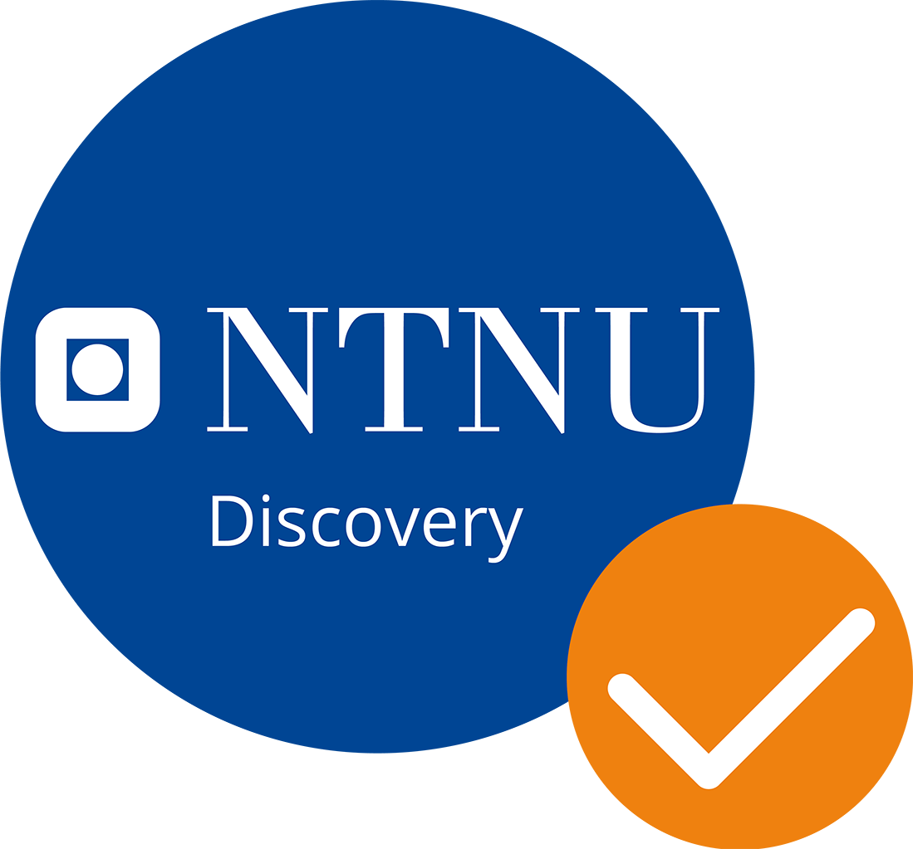

# Synesyn documentation

Pick the documentation pathway that best describes your needs.

## I want to run a session

You are facilitating a workshop, or exploring what the software does. Start at
**[Using Synesyn](user-guide/README.md)**.

- [Getting started](user-guide/getting-started.md) — install it and open your
  first session.
- [ScenSyn](user-guide/scensyn.md) — the session runtime, and how to tell which of
  its two session types you actually want.
- [Workshop Catalyst facilitator manual](user-guide/workshop-catalyst-facilitator-manual.md)
  — running a facilitated group session end to end, when the room must decide.
- [Story Catalyst](user-guide/story-catalyst.md) — narrative and cultural sessions,
  and its three scenario collections.
- [Glossary](concepts/glossary.md) — what we mean by *closure*, *artifact*,
  *session type*. Worth ten minutes before the rest.
- [Troubleshooting](user-guide/troubleshooting.md) — when something misbehaves
  mid-session.

## I want to work on it

You are reading or changing the code. Start at
**[Developing Synesyn](developer-guide/README.md)**.

- [Local development](developer-guide/local-dev.md) — prerequisites, the LimboAI
  step, and getting the hub and client running.
- [Architecture](developer-guide/architecture.md) and
  [code map](developer-guide/code-map.md) — the shape of the system, and where
  things live.
- [Building on Synesyn](developer-guide/building-on-synesyn.md) — the layer
  boundaries, and how to add a scenario, a collection, a session type or an
  application of your own.
- [System map](SYSTEM_MAP.md) — repository layout, which document owns what, and
  the checks to run before you commit.
- [Contributing](https://github.com/Metapunkt/Synesyn/blob/main/CONTRIBUTING.md)
  — how to propose a change, and what must pass before you do.

## Why it is the way it is

Reference material both audiences reach for eventually.

| Where | Question it answers |
| --- | --- |
| [Concepts](concepts/README.md) | What do the conceptual instruments mean? |
| [Product requirements](product-requirements/README.md) | What problem is this solving, and how is success measured? |
| [Architectural decisions](architectural-decisions/README.md) | Why is it built this way? Append-only, including the decisions we reversed. |
| [Implementation contracts](implementation_docs/README.md) | What must the system do? Normative, and the final word on behaviour. |
| [Harness run specs](technical-review/run_specs/README.md) | How is behaviour verified, without trusting prose? (ADR 0006) |

Work trackers and delivery history are deliberately not archived here. They live in
[`implementation_tracking/`](https://github.com/Metapunkt/Synesyn/blob/main/implementation_tracking/README.md),
because a checklist records intent and not necessarily actual implementation.
(ADR 0025).

## Credit and licence

© 2025 “Synesyn” by Ayodele Arigbabu, Norwegian University of Science and Technology

This documentation is [CC BY-SA 4.0](https://creativecommons.org/licenses/by-sa/4.0/). The source code is MIT. See [`LICENSE`](https://github.com/Metapunkt/Synesyn/blob/main/LICENSE).

The Metapunkt Project has been supported with NOK 200,000 in pilot development support from NTNU Discovery as part of a six-month grant awarded in December 2025, to support further development of the Synesyn framework.

